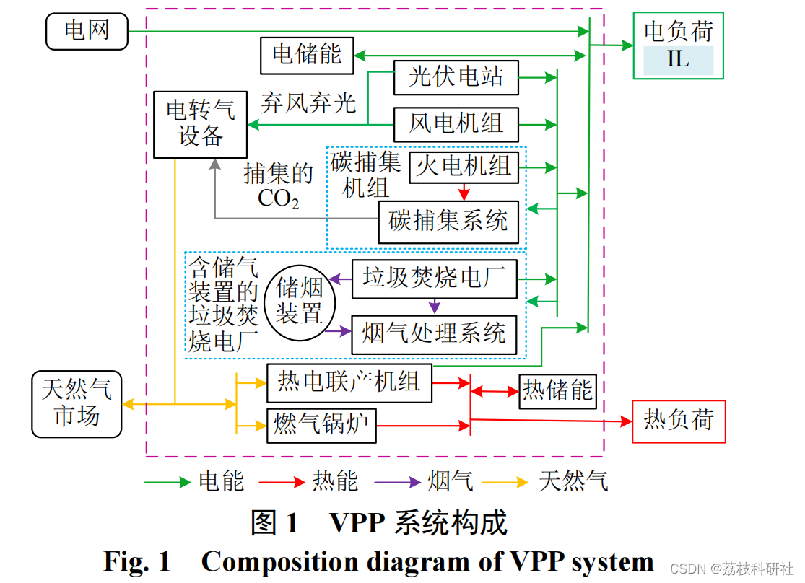
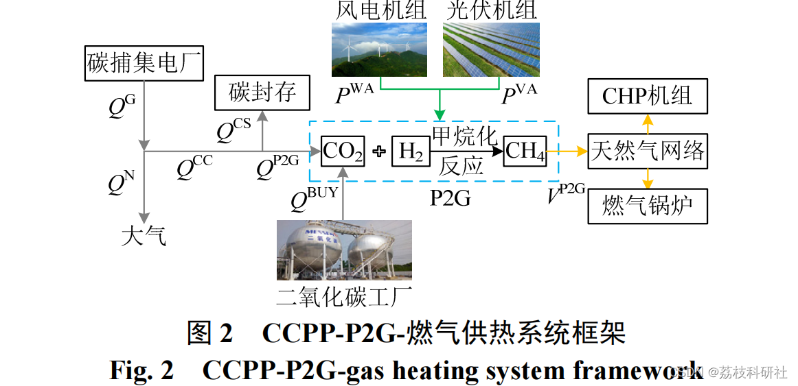
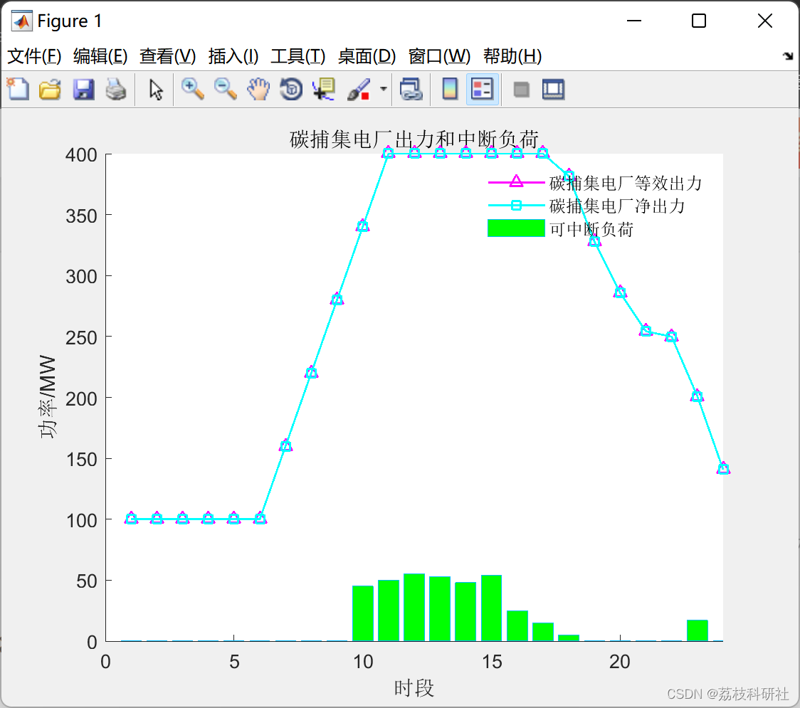
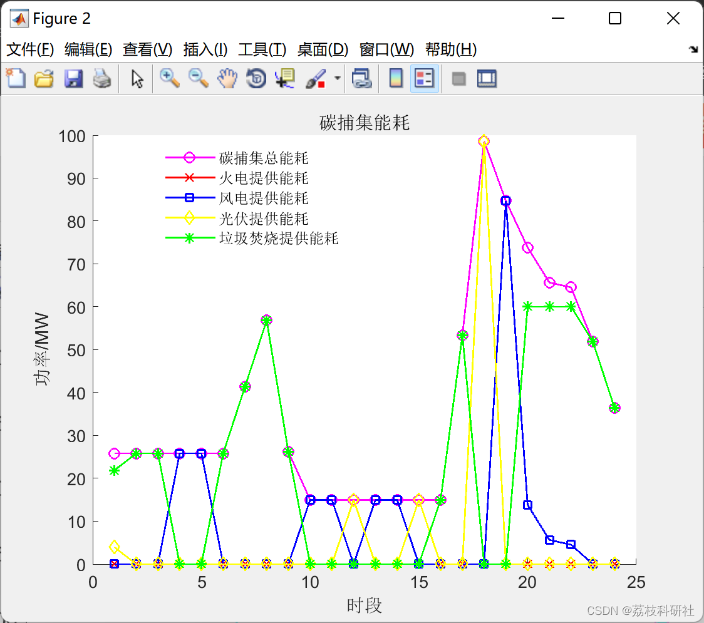
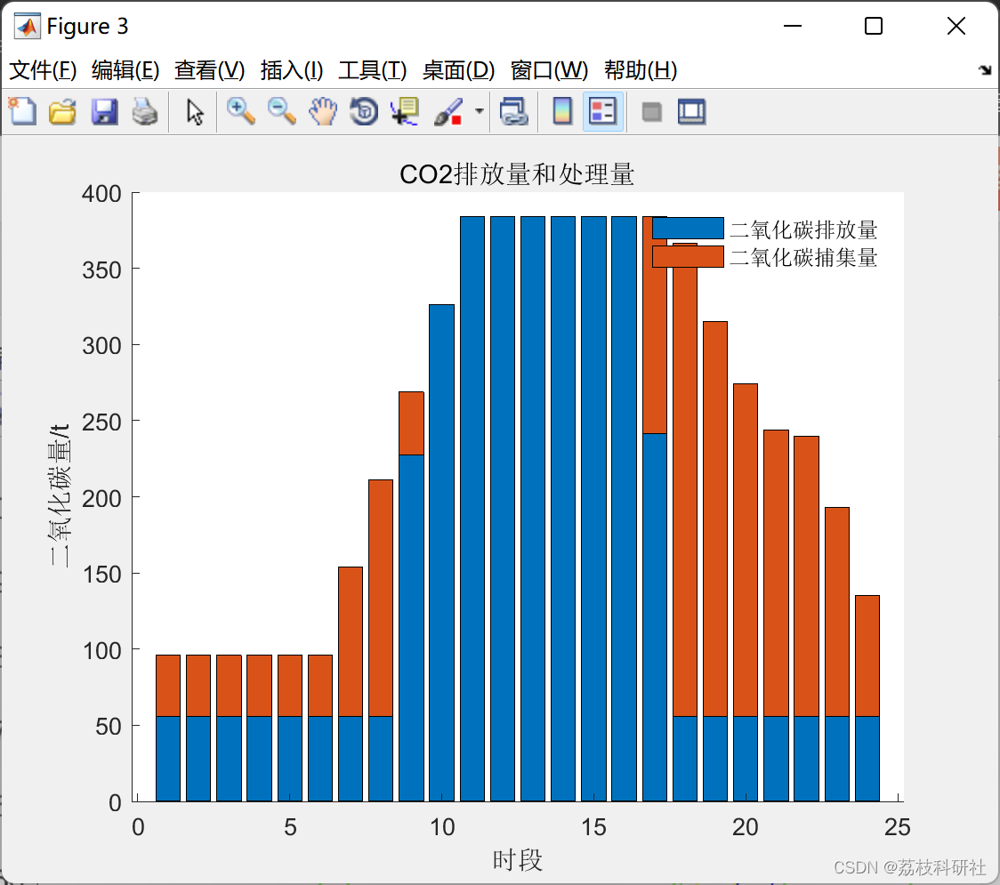
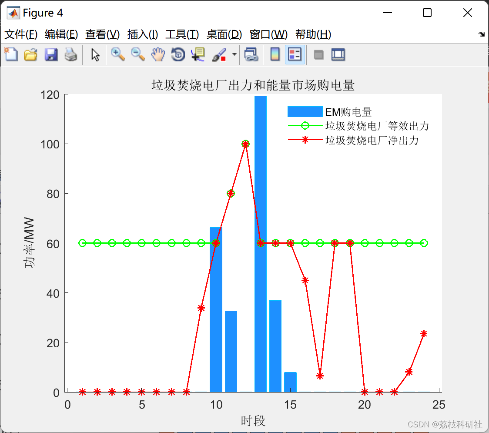
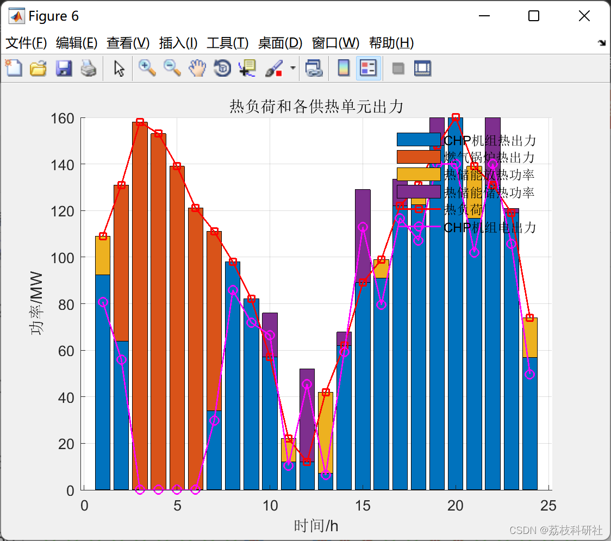
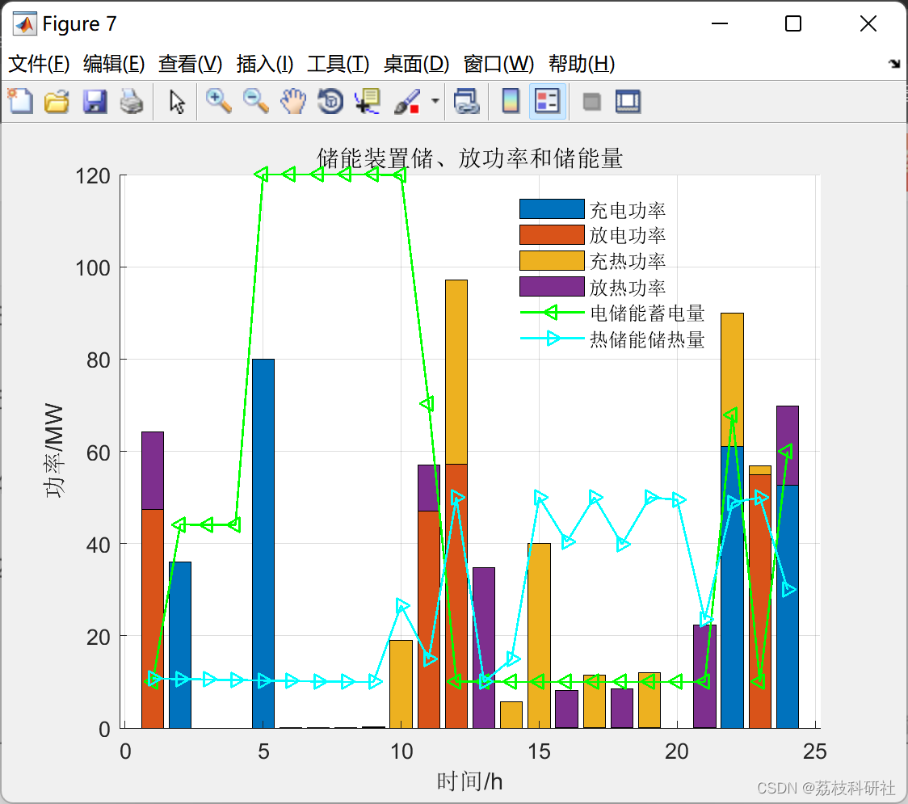

# Optimized Dispatch of Carbon Capture and Waste-to-Energy Conversion Virtual Power Plant Considering Coordinated Electricity-to-Gas (Matlab Code)

​  
Editor
1.1 Considering the P2G Collaboration, Carbon Capture and Waste-to-Energy (WTE) VPP Structure and Fundamental Principles The VPP system proposed in this paper is shown in Figure 1, which includes flexible power generation units (firepower units and waste-to-energy).
Power plants, uncontrollable power generation units (wind and photovoltaic), P2G devices, carbon capture systems, gas-fired incineration plants' gas storage facilities, electric energy storage, and thermal energy storage. Electric load consists of interruptible loads (IL) and fixed loads, and compensation fees must be provided to users according to the interruption level when IL is cut [13]. Gas turbine units consist of combined heat and power (CHP) units and gas boilers, with thermal load being coordinated by both.
Editor
Apart from CHP units, all generators can provide energy consumption to the carbon capture system and flue gas treatment system.
The integration of flue gas treatment and power generation decouples, leveraging the spatiotemporal complementarity of different energy resources in terms of energy/power. This allows for more flexible coordination with the fluctuations in renewable energy output and net load balancing. The coordinating dispatch instructions for each unit rely on data collected by the energy management system, which predicts energy market electricity prices, renewable energy output, and electric heating loads to formulate [13].
1.2 CCPP-P2G-Gas Unit Subsystem Existing VPP literature on the carbon capture power plant–P2G system framework is relatively limited, and there are no discussions on comprehensive dispatching for gas heating participation.
This paper aggregates carbon capture power plants (CCPP), P2G, and gas turbine units into a CCPP-P2G-gas turbine heating system. The CO2 captured by the CCPP is used as high-quality raw material for the P2G unit, which consumes wind and solar energy to produce natural gas that is supplied to the gas turbine units. The difference between the amount of natural gas produced by the P2G unit and the demand for natural gas by the gas turbine units is allocated to the natural gas market. The CCPP-P2G-gas heating system not only reduces the cost of CO2 storage after capture but also converts wind and solar energy waste into natural gas stored in the natural gas network, reducing the purchase costs of CHP units and gas boilers. It has a peak shaving and valley filling effect, achieving load time and space transfer. The framework is shown in Figure 2.
Editor
📚2 Operational Results Editor
Editor
Editor
Editor
Editor
Editor
PXPARAM_Simplex_Display            2
CPXPARAM_MIP_Tolerances_MIPGap         9.9999999999999995e-07
CPXPARAM_Barrier_Display            2
Tried aggregator 2 times.
MIQP Presolve eliminated 1308 rows and 290 columns.
Aggregator did 288 substitutions.
Reduced MIQP has 533 rows, 598 columns, and 1820 nonzeros.
Reduced MIQP has 48 binaries, 0 generals, 0 SOSs, and 0 indicators.
Reduced MIQP objective Q matrix has 24 nonzeros.  
Presolve time = 0.02 sec. (3.66 ticks)  
Probing fixed 0 vars, tightened 36 bounds.  
Probing time = 0.00 sec. (0.05 ticks)  
Tried aggregator 1 time.  
MIQP Presolve eliminated 1 rows and 0 columns.  
MIQP Presolve modified 34 coefficients.  
Reduced MIQP has 532 rows, 598 columns, and 1818 nonzeros.  
Reduced MIQP has 48 binaries, 0 generals, 0 SOSs, and 0 indicators.  
Reduced MIQP objective Q matrix has 24 nonzeros.  
Presolve time = 0.00 sec. (0.59 ticks)  
Probing time = 0.00 sec. (0.05 ticks)  
MIP emphasis: balance optimality and feasibility.  
MIP search method: dynamic search.  
Parallel mode: deterministic, using up to 16 threads.  
Root relaxation solution time = 0.02 sec. (7.22 ticks)  
Nodes                    Cuts/  
Node Left  Objective IInf Best Integer  Best Bound  ItCnt  Gap  
0  0 204253.7116  18        204253.7116   19  
*  0+  0           206923.7624 204253.7116      1.29%  
0  0 205911.7001  14 206923.7624   Cuts: 73   87  0.49%  
*  0+  0           206410.6951 205911.7001      0.24%  
0  0 206200.4407  13 206410.6951   Cuts: 48   139  0.10%  
0  0 206239.8844  17 206410.6951   Cuts: 28   169  0.08%  
0  0 206264.4953  17 206410.6951   Cuts: 12   193  0.07%  
0  0 206266.9487  15 206410.6951   Cuts: 12   201  0.07%  
*  0+  0           206353.2894 206266.9487      0.04%  
0  2 206266.9487  15 206353.2894 206296.8327   201  0.03%  
Elapsed time = 0.13 sec. (60.75 ticks, tree = 0.01 MB, solutions = 3)  
*  15  4   integral  0 206352.9869 206352.8155   330  0.00%  
*  17  5   integral  0 206352.8638 206352.8155   332  0.00%  
Implied bound cuts applied: 1  
Flow cuts applied: 2  
Mixed integer rounding cuts applied: 51  
Gomory fractional cuts applied: 11  
Root node processing (before b&c):  
Real time      =  0.13 sec. (60.02 ticks)  
Parallel b&c, 16 threads:  
Real time      =  0.03 sec. (12.95 ticks)  
Sync time (average) =  0.03 sec.  
Wait time (average) =  0.00 sec.  
------------  
Total (root+branch&cut) = 0.16 sec. (72.98 ticks)
🌈3 Matlab code implementation
🎉4 References

## Images

<!-- PAYMENT_BLOCK -->

## Get this dataset

- Payment link (Stripe): [Buy now](https://buy.stripe.com/3cs8yP7sY87d0vu9AB)
- Payment QR code: 

<!-- /PAYMENT_BLOCK -->
